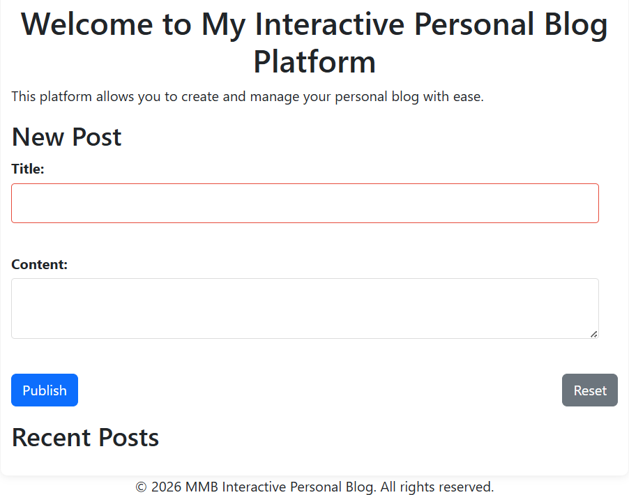
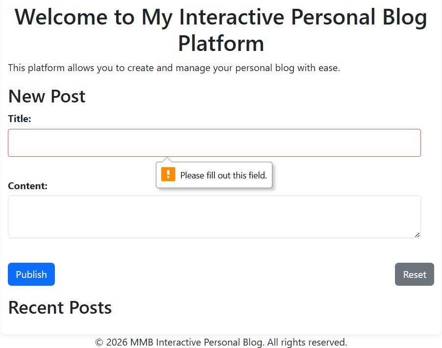
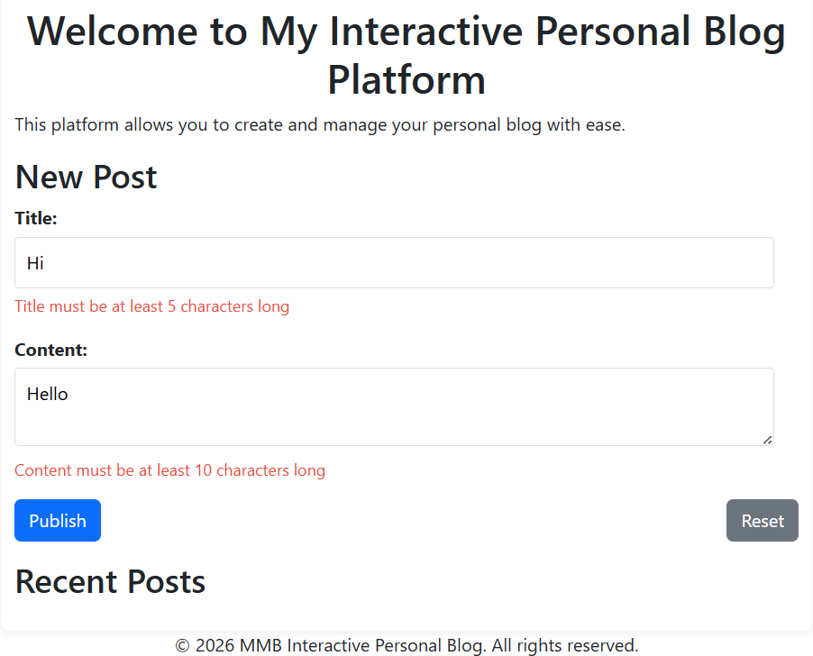
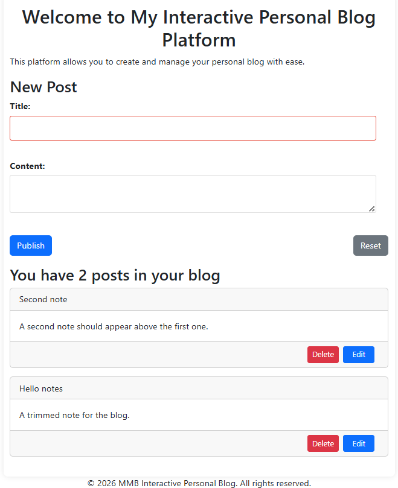
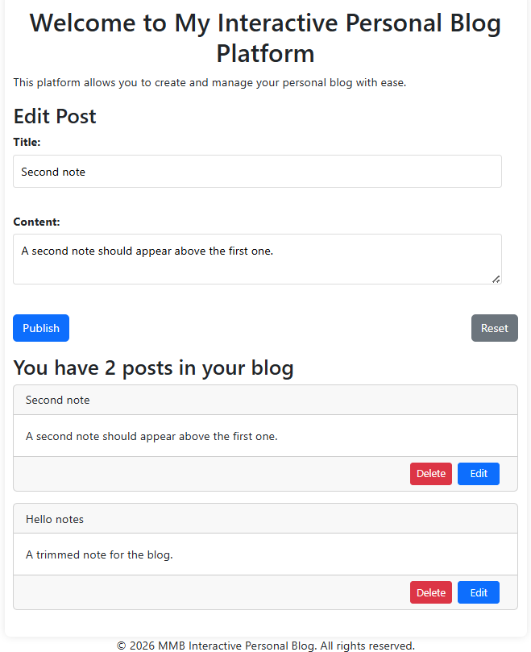

# SBA 5: The Document Object Model

One page, titled "Interactive Personal Blog", that stores blog posts in this browser.

## Description

Posts are stored under the `localStorage` key `posts`. There is no server and no install step. Bootstrap 5.3 loads from the internet, so the page needs a network connection. Open `index.html` in a browser.

The heading is "Welcome to My Interactive Personal Blog Platform", with the sentence "This platform allows you to create and manage your personal blog with ease." The footer reads "© 2026 MMB Interactive Personal Blog. All rights reserved."

`styles.css` is linked before Bootstrap, so Bootstrap sets the typeface and the white page. The custom sheet still centers the heading, draws the rounded shadowed card, turns an empty title box red, colors the error text red, and places Publish and Reset on opposite ends. At this window the card is Bootstrap's container width, about 720px.

The form is labeled "New Post". Title and Content are required. The title must be 5 to 200 characters. The content must be 10 to 1000 characters. The fields stop at 200 and 1000 characters. Before any post is saved, the list heading stays "Recent Posts".

Publish with both fields empty stays on the page. The browser shows "Please fill out this field." The red sentences under the fields stay blank, because that click never reaches the script.

As you type, a title shorter than 5 characters shows "Title must be at least 5 characters long", and content shorter than 10 characters shows "Content must be at least 10 characters long". Publish does not save that post. A value over the limit shows "Title must be no more than 200 characters long" or "Content must be no more than 1000 characters long". A title or content made only of spaces is rejected with "Title is required" or "Content is required". Spaces at the ends of a valid entry are removed before it is saved. The empty title box has a red border. The content box border stays grey, because the red border rule applies to `input` elements.

A saved post is a card with the title, the content, a red Delete button, and a blue Edit button. The newest post is placed first. The heading becomes "You have 2 posts in your blog", or "You have 1 post in your blog" when one remains. Each post also stores an id from `crypto.randomUUID()` and a timestamp from `toISOString()`. Neither is shown on the card. A tag typed in the content is rendered as HTML.

"Hello notes" was saved from a title and content that had spaces around them. "Second note" was saved after it, so it appears above.

Reloading the page keeps the posts. Deleting the last post changes the heading to "No posts available" and removes the cards. Delete removes only the post whose button was clicked.

Edit copies that post into the form and changes the heading from "New Post" to "Edit Post". Publish then updates that same post. The timestamp stays the same, and the post stays in its place in the list.

After that update, the form is cleared and the id of the post being edited is cleared, but the heading stays "Edit Post". The next Publish creates a new post while the heading still says Edit. Reset clears the fields and leaves both the "Edit Post" heading and the id, so the next Publish updates that same post.

## Screenshots

### A new post

### The list

### Editing

## Getting Started

### Dependencies

* A browser
* A network connection, because Bootstrap 5.3 loads from the internet

### Installing

No install step. Clone or download the files.

### Executing program

Open `index.html` in a browser.

## Help

Publish with empty fields shows the browser message "Please fill out this field." and does not reach the script. After an update, the heading stays "Edit Post" even though the editing id was cleared, so the next Publish creates a new post. Reset leaves the heading and the id, so the next Publish updates that same post. A tag typed in the content is rendered as HTML.

## Authors

[Mamadou Moussa Balde](https://www.linkedin.com/in/2mb/)

## Version History

* Current local run
    * Two posts, "Second note" above "Hello notes"
    * The card width at this window was about 720px

## License

This folder does not include a `LICENSE.md` file.

## Acknowledgments

* [README template](https://gist.github.com/DomPizzie/7a5ff55ffa9081f2de27c315f5018afc)

## Development Process & Reflection

This is an Interactive Personal Blog Platform built with HTML, CSS (with Bootstrap 5), and vanilla JavaScript. The application allows users to create, read, update, and delete (CRUD) blog posts seamlessly on a single page. All data is saved persistently in the browser using Local Storage, ensuring that posts remain available even after refreshing the page.

**Process:**

* Structured the application with HTML5 tags and Bootstrap for responsive styling and a clean UI.
* Used vanilla JavaScript to handle DOM manipulation, form event listeners, and data persistence via the `localStorage` API.
* Implemented **Event Delegation** on the recent posts container to efficiently manage "Edit" and "Delete" actions on dynamically created post elements.
* Created real-time form validation to provide immediate feedback to the user on title (5-200 characters) and content (10-1000 characters) requirements before form submission.

**Challenges & Solutions:**

* **Challenge:** Differentiating between creating a new post and editing an existing one using the same form. **Solution:** I introduced a global variable `editingPostId` to track the form's state. If an ID is present, the form submission updates the corresponding post object in the `posts` array; if it is `null`, it creates a brand new post.
* **Challenge:** Managing event listeners for dynamically added DOM elements (like delete and edit buttons). **Solution:** I utilized event delegation by attaching a single click event listener to the parent container (`.recent-posts`). This catches clicks on any dynamically generated buttons, making the code more efficient and robust.

**Known issues:**

* Data is stored strictly in the browser's `localStorage`, meaning posts are device/browser-specific and will be lost if the browser's data/cache is cleared.
* There is no database or user authentication system.
* Future plans could include adding image uploads, rich text editing functionality, pagination for displaying a large number of posts, and integrating a backend database for cross-device access.
